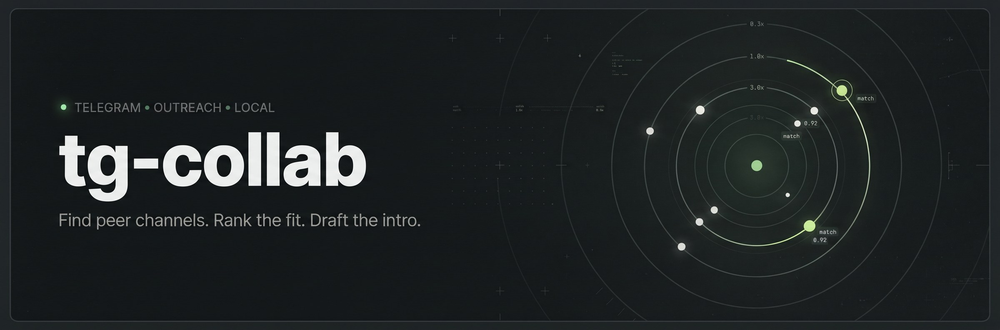
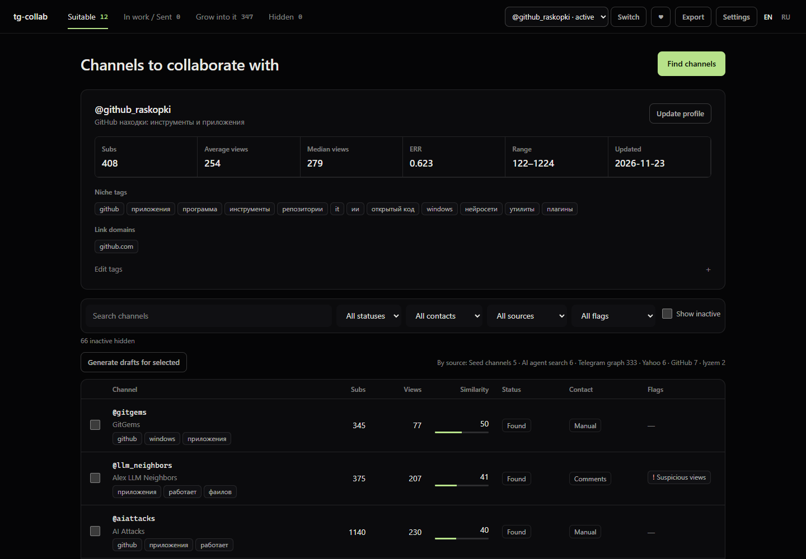

<p align="center">
  
</p>

# tg-collab

<p align="center">
  
  
</p>

<p align="center">A local tool for finding partners and collaborations in Telegram - a CLI, a web UI, and an AI-agent skill. It profiles your channel's niche and metrics, finds channels of similar topic and size, keeps a local CRM, and drafts messages without automatic sending.</p>

<p align="center">
  <a href="#install-with-your-ai-agent">Install with your AI agent</a> |
  <a href="#manual-install">Manual install</a> |
  <a href="#screenshots">Screenshots</a> |
  <a href="README.ru.md">Русский</a> |
  <a href="SKILL.md">Agent skill</a>
</p>

## Install with your AI agent

This is the primary path. Copy the repository URL, open OpenCode, Claude Code,
Cursor, Codex, or another harness with shell access, and paste this line:

```
Install tg-collab from https://github.com/nzeronfourme/tg-collab
```

The agent reads this repository and sets it up.

## Manual install

The terminal fallback:

```
git clone https://github.com/nzeronfourme/tg-collab.git tg-collab
cd tg-collab
uv sync
uv run tg-collab --version
```

Profile your channel, run a bounded search, and open the UI:

```
uv run tg-collab init @your_channel
uv run tg-collab find --max-channels 40
uv run tg-collab ui
```

`init` needs the public channel preview (`t.me/s/`). A full `find` can take tens
of minutes; `--max-channels 40` keeps one pass short.

## Screenshots

The dashboard: profile card with niche tags, filters, and the ranked channel
table.



## Features

- **Profile.** `tg-collab init @channel` reads the public preview and stores
  title, description, subscribers, average and median views, ERR, cadence, the
  pinned post, and up to 30 recent posts. It builds a niche (up to 12 terms, 5
  hashtags, 5 link domains), detects the language, and sets a partner range of
  `0.3x` to `3x` of your subscribers.
- **Ranking.** `similarity` is a TF-IDF cosine, `size_fit` rewards channels near
  your size, and `score` sorts the list. A weak match is kept, not deleted, and
  re-scored when your channel grows.
- **Broad discovery.** The `t.me/s/` mention graph, your local AI agent, seven
  HTML engines, GitHub project chats, Hacker News, optional TGStat, and optional
  seed channels all feed one candidate pool.
- **Local Web UI.** `tg-collab ui` opens `127.0.0.1`: one primary search, tabs
  with counts, a channel workspace with metrics, notes and drafts, compact
  settings, and Markdown or CSV export.
- **Readable data.** Inactive channels (no post for 14 days) are hidden by
  default, language is a visibility filter, and every read command prints clean
  `--json`.

## Reference

<details>
<summary>Commands, sources, and settings</summary>

- **Explain.** `tg-collab explain @channel` returns one verdict: `absent`,
  `stored_low`, `out_of_range`, `inactive`, `hidden`, `hidden_language`,
  `invite_only`, or `present`. `5.0` is a diagnostic floor, not a filter.
  `--check` makes one `t.me` probe; without it nothing goes to the network.
- **Statuses.** `ok`, `empty`, `disabled`, `no_key`, `captcha`, `quota`,
  `blocked`, `error`. An all-empty niche is a finished run; a run where no
  source answered exits with code `1`.
- **Sources.** `tg_graph`, GitHub, optional TGStat, and the HTML engines
  `search_bing`, `search_yahoo`, `search_startpage` (plus Mojeek, Yandex,
  Google, DuckDuckGo), each with its own `sources_search_*` toggle such as
  `sources_search_bing`. Hacker News is keyless through `hn.algolia.com`
  (`search_hn`, toggle `sources_search_hn`).
- **Queries.** Five families: `site:t.me`, `"<term>" telegram`,
  `"<term>" телеграм`, `#<hashtag>`, and `"<domain>" telegram`.
  `search_max_queries` defaults to 10 and caps at 12; engines keep their own
  relevance order.
- **Budgets.** `find_max_candidates` (default `500`) is the first-round
  candidate budget; graph edges continue beyond it. `find_max_channels`,
  `--depth`, and `--max-channels 40` bound the run.
- **Language.** `--lang all|cyrillic|latin|cjk` on `list` and `export`. The
  default view is your language plus English plus `unknown`; language never
  changes `similarity`, `size_fit`, or `score`. Invite links (`t.me/+`) from
  your own posts become manual `leads`.
- **Activity and niche.** `--activity all` and "Show inactive" bring back rows
  hidden by `flag_inactive_days` (14 days). `tg-collab niche --refresh`,
  `--set`, and `--clear` edit the niche that drives queries and the similarity
  bonus.
- **Profiles.** One install can track several channels; the header switcher
  changes the active one, and `tg-collab profile list|add|use|remove` does the
  same from the CLI. The last profile cannot be removed.
- **Agent search.** `agent_commands` runs one command per line;
  `agent_search_concurrency` (1-3, default 2), `agent_search_timeout_sec`
  (default 600), and `agent_search_max` (default 30) bound the batch. The
  automatic search uses the compact `search.*` brief; the richer `research.*`
  brief stays for `tg-collab agent-prompt`, whose `--json` output also carries
  `template` and `posts_sample`.
- **Import.** `tg-collab import` is manual: every target passes the `t.me` gate,
  invite links become `leads`, and `agent_import_max` caps the batch.
- **Optional keys.** `TGSTAT_TOKEN`, `GITHUB_TOKEN`, `BRAVE_SEARCH_API_KEY`,
  `SEARXNG_URL`. On a free TGStat plan `quota_foreign_channel` skips TGStat for
  the rest of the run; the other sources continue.
- **Hidden settings.** `ui_port`, `http_delay_ms`, `http_timeout_sec`,
  `http_retries`, `profile_post_limit`, `search_cache_days`, `search_delay_ms`,
  `github_queries`, `github_max_repos`, `github_max_repos_unauth`,
  `tgstat_country`, `tgstat_categories`, `tgstat_queries`, `agent_import_max`,
  `flag_cv_threshold`, `flag_ratio_threshold`, `flag_err_threshold` stay in
  `SETTING_DEFAULTS` and work through `TGCOLLAB_<KEY>`.
- **Storage and license.** Data lives in `.tg-collab/data.db`; the project is
  `MIT`.

</details>

## Privacy and sending control

- The tool **never sends** messages, never joins chats, and has no Telegram
  bot. The last step is always a human pasting the text. It works with public
  data or your own official API keys only.
- Discovery sends niche terms, hashtags, and link domains to the HTML engines,
  and up to three terms to `hn.algolia.com`. Invite links (`t.me/+`) stay local
  `leads`. CAPTCHA and login walls are recorded as `captcha` and never bypassed;
  no paid API is required.
- Everything is local: SQLite at `.tg-collab/data.db` (override with
  `TGCOLLAB_DATA_DIR`), the server, settings, and drafts. That file is the
  single source of truth for the CLI, the agent, and the UI.

## License

MIT. See [`LICENSE`](LICENSE).
