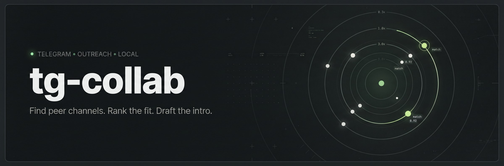
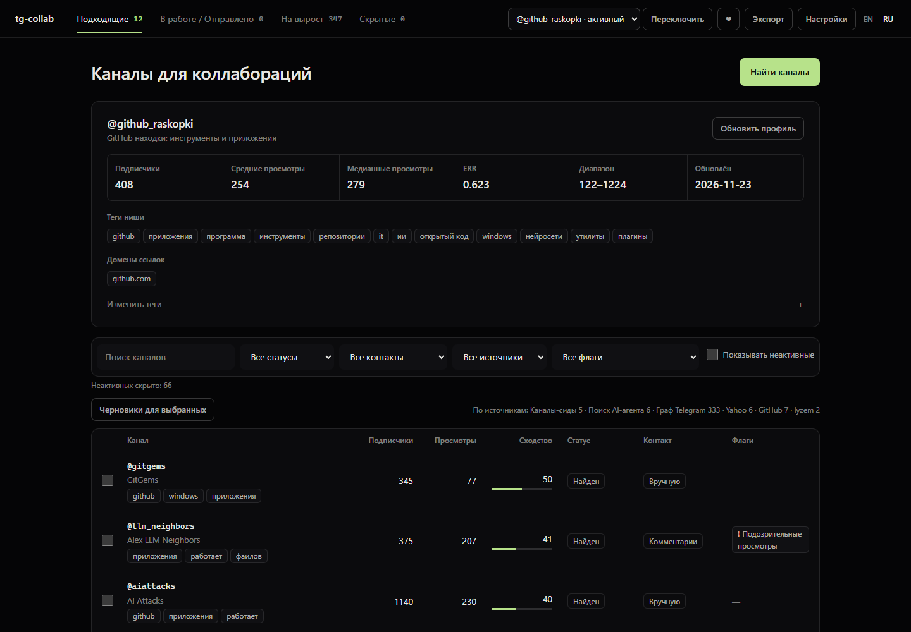

<p align="center">
  
</p>

# tg-collab

<p align="center">
  
  
</p>

<p align="center">Локальный инструмент для поиска партнёров и коллабораций в Telegram — работает через CLI, веб-интерфейс и как скилл для ИИ-агентов. Разбирает нишу и метрики вашего канала, находит похожие по тематике и размеру площадки, ведёт локальную CRM-базу и готовит черновики сообщений без автоматических рассылок.</p>

<p align="center">
  <a href="#установка-с-ии-агентом">Установка с ИИ-агентом</a> |
  <a href="#ручная-установка">Ручная установка</a> |
  <a href="#скриншоты">Скриншоты</a> |
  <a href="README.md">English</a> |
  <a href="SKILL.ru.md">Скилл для агента</a>
</p>

## Установка с ИИ-агентом

Это самый быстрый способ. Откройте OpenCode, Claude Code, Cursor, Codex или другой агент с доступом к терминалу и отправьте ему команду:

```
Установи tg-collab из https://github.com/nzeronfourme/tg-collab
```

Агент сам изучит репозиторий и настроит проект.

## Ручная установка

Установка из терминала:

```
git clone https://github.com/nzeronfourme/tg-collab.git tg-collab
cd tg-collab
uv sync
uv run tg-collab --version
```

Создайте профиль канала, запустите быстрый поиск и откройте веб-интерфейс:

```
uv run tg-collab init @твой_канал
uv run tg-collab find --max-channels 40
uv run tg-collab ui
```

Для `init` у канала должно быть открыто публичное веб-превью (`preview`, `t.me/s/`). Полный поиск `find` может занимать десятки минут, поэтому для первого прогона лучше ограничить выборку флагом `--max-channels 40`.

## Скриншоты

Дашборд с карточкой профиля, нишевыми тегами, фильтрами и ранжированной таблицей найденных каналов:



## Возможности

- **Профиль канала.** Команда `tg-collab init @channel` читает публичное превью и собирает основные метрики: название, описание, число подписчиков, средний и медианный охват, ERR, частоту публикаций, закреп и до 30 последних постов. На их основе автоматически формируется ниша (до 12 ключевых слов, 5 хэштегов и 5 доменов ссылок), определяется язык и задаётся целевой диапазон партнёров — от `0.3x` до `3x` от размера вашего канала.
- **Ранжирование.** Тематическая близость (`similarity`) считается через косинусное сходство TF-IDF, метрика `size_fit` отдаёт приоритет каналам сопоставимого размера, а итоговый `score` сортирует список. Слабые совпадения не удаляются из базы — они автоматически пересчитываются по мере роста вашего канала.
- **Поиск по разным источникам.** В единую базу кандидатов собираются результаты из графа упоминаний `t.me/s/`, локального ИИ-агента, семи поисковых движков, чатов проектов на GitHub, Hacker News, опционального TGStat и стартовых каналов.
- **Локальный веб-интерфейс.** Команда `tg-collab ui` запускает дашборд на `127.0.0.1`: поиск, вкладки со счётчиками, карточка каждого канала с метриками, заметками и черновиками сообщений, настройки и экспорт в Markdown или CSV.
- **Чистые данные.** Заброшенные каналы (без новых постов 14 дней) скрываются по умолчанию, язык работает как фильтр отображения, а любая команда чтения умеет отдавать чистый `--json`.

## Справочник

<details>
<summary>Команды, источники и настройки</summary>

- **Диагностика (`explain`).** `tg-collab explain @channel` показывает причину, по которой канал попал или не попал в выдачу: `absent`, `stored_low`, `out_of_range`, `inactive`, `hidden`, `hidden_language`, `invite_only` или `present`. Порог `5.0` используется только для диагностики, а не для жёсткой фильтрации. Флаг `--check` делает один запрос к `t.me`; без него команда работает полностью офлайн.
- **Статусы источников.** `ok`, `empty`, `disabled`, `no_key`, `captcha`, `quota`, `blocked`, `error`. Если по нише ничего не нашлось, запуск завершается штатно; код возврата `1` выдаётся только если не ответил ни один источник.
- **Источники.** Граф упоминаний `tg_graph`, GitHub, опциональный TGStat и поисковики `search_bing`, `search_yahoo`, `search_startpage` (а также Mojeek, Yandex, Google, DuckDuckGo) — каждый включается отдельным флагом `sources_search_*` (например, `sources_search_bing`). Hacker News работает без API-ключа через `hn.algolia.com` (`search_hn`, флаг `sources_search_hn`).
- **Поисковые запросы.** Используются пять шаблонов: `site:t.me`, `"<term>" telegram`, `"<term>" телеграм`, `#<hashtag>` и `"<domain>" telegram`. Лимит `search_max_queries` — 10 по умолчанию и 12 максимум; порядок выдачи поисковиков сохраняется.
- **Лимиты.** `find_max_candidates` (по умолчанию `500`) ограничивает число кандидатов в первом раунде, дальше поиск идёт по графу упоминаний. Объём прогона регулируется через `find_max_channels`, `--depth` и `--max-channels 40`.
- **Язык.** Флаг `--lang all|cyrillic|latin|cjk` работает в `list` и `export`. По умолчанию показываются язык владельца, английский и `unknown`; фильтр языка не влияет на расчёт `similarity`, `size_fit` и `score`. Пригласительные ссылки (`t.me/+`) из ваших постов сохраняются отдельно как ручные лиды (`leads`).
- **Активность и ниша.** Флаг `--activity all` и переключатель «Показывать неактивные» возвращают каналы, скрытые по `flag_inactive_days` (14 дней). Команды `tg-collab niche --refresh`, `--set` и `--clear` управляют нишей, от которой зависят поисковые запросы и оценка похожести.
- **Мультипрофильность.** Одна установка поддерживает несколько каналов: активный профиль можно менять через переключатель в шапке UI или командами `tg-collab profile list|add|use|remove`. Последний оставшийся профиль удалить нельзя.
- **Агентский поиск.** `agent_commands` выполняет по одной команде на строку; размер пачки ограничивают `agent_search_concurrency` (от 1 до 3, по умолчанию 2), `agent_search_timeout_sec` (по умолчанию 600) и `agent_search_max` (по умолчанию 30). Автоматический поиск использует компактный бриф `search.*`, а расширенный `research.*` доступен через `tg-collab agent-prompt` (с `--json` дополнительно отдаёт `template` и `posts_sample`).
- **Импорт.** `tg-collab import` запускается вручную: каждый канал проверяется через `t.me`, пригласительные ссылки попадают в `leads`, а объём пачки ограничивается `agent_import_max`.
- **Опциональные API-ключи.** `TGSTAT_TOKEN`, `GITHUB_TOKEN`, `BRAVE_SEARCH_API_KEY`, `SEARXNG_URL`. На бесплатном тарифе TGStat при получении `quota_foreign_channel` этот источник отключается до конца запуска, а остальные продолжают работу.
- **Дополнительные настройки.** Параметры `ui_port`, `http_delay_ms`, `http_timeout_sec`, `http_retries`, `profile_post_limit`, `search_cache_days`, `search_delay_ms`, `github_queries`, `github_max_repos`, `github_max_repos_unauth`, `tgstat_country`, `tgstat_categories`, `tgstat_queries`, `agent_import_max`, `flag_cv_threshold`, `flag_ratio_threshold`, `flag_err_threshold` заданы в `SETTING_DEFAULTS` и переопределяются через переменные окружения `TGCOLLAB_<KEY>`.
- **Хранение данных.** Вся база лежит в `.tg-collab/data.db`; проект распространяется под лицензией `MIT`.

</details>

## Приватность и контроль отправки

- Инструмент **не отправляет** сообщения, не вступает в чаты и не работает как Telegram-бот. Финальную отправку всегда делает человек. Используются только открытые данные или ваши собственные API-ключи.
- При поиске в поисковые движки передаются нишевые термины, хэштеги и домены ссылок, а до трёх терминов отправляются в `hn.algolia.com`. Пригласительные ссылки (`t.me/+`) остаются только локально в списке `leads`. Страницы с капчей или требованием авторизации помечаются статусом `captcha` и не обходятся; платные API не требуются.
- Всё хранится локально: база SQLite в `.tg-collab/data.db` (путь меняется через `TGCOLLAB_DATA_DIR`), веб-сервер, настройки и черновики. CLI, ИИ-агент и веб-интерфейс работают с одной и той же базой.

## Лицензия

MIT. Подробности в файле [`LICENSE`](LICENSE).
